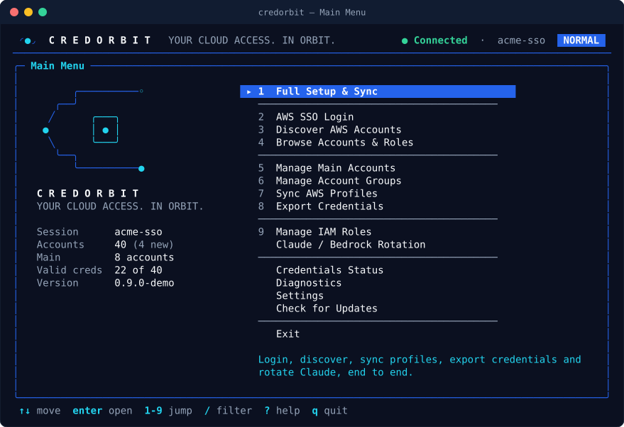
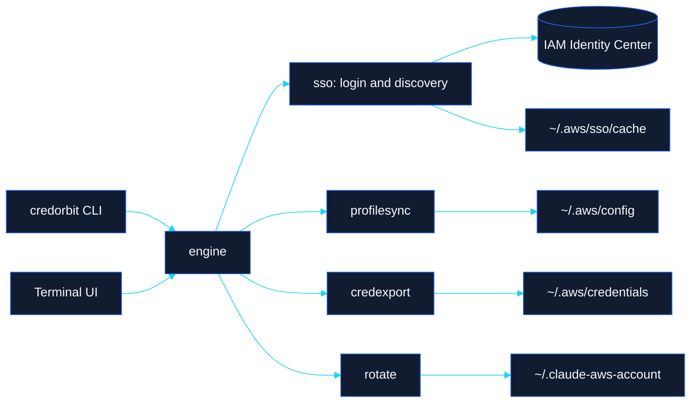

<div align="center">

<picture>
  <source media="(prefers-color-scheme: dark)" srcset="assets/brand/wordmark-dark.svg">
  <source media="(prefers-color-scheme: light)" srcset="assets/brand/wordmark-light.svg">
  
</picture>

### Your Cloud Access. In Orbit.

[](https://github.com/PiniPP/credorbit/actions/workflows/ci.yml)
[](go.mod)
[](LICENSE)
[](COMMERCIAL.md)
[](https://github.com/PiniPP/credorbit/releases)

**[Install](#-install)** · **[Quick start](#-quick-start)** · **[Guides](#-documentation)** · **[Security](docs/SECURITY.md)**

</div>

CredOrbit is a single static binary that keeps your AWS IAM Identity Center access in a stable orbit: it signs you in, discovers every account and role assigned to you, keeps `~/.aws/config` in sync (with reviewed changes only), fetches temporary credentials in parallel and rotates the AWS account Claude Code uses for Amazon Bedrock. You get a scriptable CLI and a full-screen terminal UI on top of the same engine. It replaces the legacy `populate-aws-creds.sh` Bash script and can import its settings once.

<div align="center">
  
  <br><sub>The main menu of <code>credorbit</code> (demo data, <code>credorbit ui --demo</code>)</sub>
</div>

## ▶️ See it in action

<div align="center">
  <a href="assets/video/credorbit-demo.mp4">
    
  </a>
  <br><sub>72-second tour — browse &amp; search accounts · Main Accounts · Full Setup &amp; Sync with reviewed changes · live export · Claude/Bedrock rotation · diagnostics.
  <br><a href="assets/video/credorbit-demo.mp4"><b>Watch in HD (MP4)</b></a> · recorded with <code>credorbit ui --demo</code> (synthetic data)</sub>
</div>

## ✨ Features

<table>
<tr>
<td width="33%" valign="top">

**🔐 Native SSO login**<br>
Browser (PKCE) or device-code sign-in, silent refresh, and the same `~/.aws/sso/cache` the AWS CLI uses.

</td>
<td width="33%" valign="top">

**🛰️ Account discovery**<br>
Every account and role assigned to you, cached for offline browsing, compared against your AWS config.

</td>
<td width="33%" valign="top">

**🔄 Reviewed profile sync**<br>
New accounts become profiles; stale ones are removed only after review, behind an 80 % safeguard.

</td>
</tr>
<tr>
<td valign="top">

**⚡ Parallel credentials**<br>
Temporary role credentials for one, a group or all profiles, with live progress and per-profile errors.

</td>
<td valign="top">

**⭐ Main Accounts & groups**<br>
A built-in Main group plus custom groups (`dev`, `prod`, …) as export scopes. Groups never touch AWS files.

</td>
<td valign="top">

**🤖 Claude / Bedrock rotation**<br>
Rotate the account Claude Code uses, skip expired credentials, optionally verify Bedrock access first.

</td>
</tr>
<tr>
<td valign="top">

**🖥️ Terminal UI + CLI**<br>
A Bubble Tea UI for humans and `--yes` / `--json` / exit codes for scripts. Same engine underneath.

</td>
<td valign="top">

**🌐 Corporate networks**<br>
Extra CAs are appended to the system roots, so one config works on and off TLS-intercepting proxies.

</td>
<td valign="top">

**🛡️ Safe file handling**<br>
Locks, re-parse validation, timestamped backups, atomic writes and owner-only permissions.

</td>
</tr>
</table>

## 💼 Licensing

> [!IMPORTANT]
> Free for personal, educational, research and non-profit use. Companies and enterprises need a paid commercial license — see [COMMERCIAL.md](COMMERCIAL.md).

## 💡 Why CredOrbit

| | Legacy script | CredOrbit |
|---|---|---|
| AWS access | Shells out to the AWS CLI, Python and `curl` | Native AWS SDK for Go; **no AWS CLI needed** |
| SSO token | Passed on the command line (visible in `ps`) | Stays in memory and the 0600 token cache |
| Accounts and roles | Hardcoded lists, script edits its own source | Discovered live; **nothing organisation-specific is compiled in** |
| `~/.aws/credentials` | Rewritten with only the processed profiles | Only processed sections replaced; failed profiles keep their previous credentials |
| File writes | Temp file in `/tmp`, then `mv` | Lock, validate, backup, same-directory temp file, fsync, atomic rename |
| Stale profiles | Removed automatically | **Reviewed** removal, blocked on incomplete or cached discovery |
| Role changes | Strongest role persisted silently | Configured role by default; persisting a different role is previewed |

See the full [feature-parity matrix](docs/MIGRATION_MATRIX.md).

## 🧭 How it works



## 📦 Install

| Method | Command |
|---|---|
| Go toolchain | `go install github.com/PiniPP/credorbit/cmd/credorbit@latest` |
| macOS / Linux script | `curl -fsSL https://raw.githubusercontent.com/PiniPP/credorbit/main/packaging/install.sh \| sh` |
| Windows script | `powershell -ExecutionPolicy Bypass -File install.ps1 -AddToPath` |
| Release archive | Download from [Releases](https://github.com/PiniPP/credorbit/releases) and verify with `checksums.txt` |
| From source | `git clone https://github.com/PiniPP/credorbit && cd credorbit && make install` |
| Homebrew | Tap coming with the first release |

Both install scripts verify the archive against the release's `checksums.txt` (SHA-256) and never need `sudo` or administrator rights. To verify a manual download:

```sh
sha256sum --check --ignore-missing checksums.txt     # Linux
shasum -a 256 --check --ignore-missing checksums.txt # macOS
```

Full instructions, shell completion and uninstalling: [docs/INSTALLATION.md](docs/INSTALLATION.md).

## 🚀 Quick start

```sh
# 1. Create an SSO session (skip if ~/.aws/config already has an [sso-session] block)
credorbit login --name acme --start-url https://d-1234567890.awsapps.com/start --region us-east-1

# 2. Open the terminal UI and choose "Full Setup & Sync"
credorbit

# ...or run the same workflow non-interactively
credorbit setup --yes
```

> [!TIP]
> Coming from `populate-aws-creds.sh`? Run `credorbit import` first. It reads the script (never modifies it) and carries over your Main profiles, rotation accounts, fallback roles, CA bundle and paths. See [docs/MIGRATION.md](docs/MIGRATION.md).

> [!NOTE]
> By default (Normal mode) profiles work through the shared SSO token cache, so `~/.aws/credentials` is **not** written. Turn on `export.enabled`, run `credorbit setup --export`, or use Script-compatible mode if your tools need static credential sections.

## ⌨️ Usage cheatsheet

| Task | Command |
|---|---|
| Open the terminal UI | `credorbit` or `credorbit ui` |
| Try the UI with fake data | `credorbit ui --demo` |
| Full Setup & Sync | `credorbit setup` |
| Sign in / force a new sign-in | `credorbit login` / `credorbit login --force` |
| Sign in without a local browser | `credorbit login --device` |
| List assigned accounts and roles | `credorbit discover` |
| Browse accounts | `credorbit accounts list --filter prod --sort env` |
| Preview profile changes | `credorbit sync --dry-run` |
| Add new profiles and review stale ones | `credorbit sync --remove-stale` |
| Credentials for Main Accounts | `credorbit export --group main` |
| Credentials for one profile | `credorbit export --profile p_acme-dev` |
| Edit a group | `credorbit groups add dev 111111111111 p_acme-dev` |
| Choose the preferred role | `credorbit roles set p_acme-dev ReadOnlyAccess` |
| Rotate the Claude Code account | `credorbit rotate` |
| Local summary (no network) | `credorbit status` |
| Diagnose problems | `credorbit doctor` |
| Settings | `credorbit config list` / `credorbit config set KEY VALUE` |

Global flags: `--session`, `--config`, `--yes/-y`, `--json`, `--compat`, `--no-color`, `--ascii`, `--no-extra-ca`, `--verbose/-v`. The complete reference is in the [User Guide](docs/USER_GUIDE.md).

## ⚖️ Normal vs Script-compatible mode

| Behaviour | Normal mode (default) | Script-compatible mode |
|---|---|---|
| Role used | `sso_role_name` of the profile (`configured`) | Assigned roles strongest first, then configured, then fallbacks (`script`) |
| Persist the role that worked | Only after review (`--update-roles`) | Automatically |
| Write `~/.aws/credentials` | No (`export.enabled=false`) | Yes |
| `p_x` written as `[x]` | Yes (`export.strip_prefix=true`) | Yes |
| New accounts in Main exports | No | Yes, for that run |
| Claude rotation during setup | Only with `--rotate` | Yes (when rotation accounts exist) |
| Stale profile removal | Reviewed | Reviewed |

Switch permanently with `credorbit config set mode compat`, or for one run with `--compat`.

## ⭐ Main Accounts & groups

Main is a built-in group that cannot be deleted or renamed. When it has members, `credorbit setup` uses it as the default scope; otherwise every profile with the prefix is used. Custom groups (lowercase names such as `dev` or `prod`) are saved selections you can pass with `--group`.

```sh
credorbit groups add main p_acme-billing-prd 222222222222
credorbit groups create dev --description "Development accounts"
credorbit groups sync dev        # add missing profiles, then export the group
```

Groups only change `config.yaml`; they never create or delete AWS profiles or credentials. See [docs/ACCOUNT_GROUPS.md](docs/ACCOUNT_GROUPS.md).

## 🤖 Claude Code / Bedrock rotation

```sh
credorbit rotate accounts set acme-bedrock-01,acme-bedrock-02
credorbit config set export.enabled true   # rotation needs exported, unexpired credentials
credorbit export --group main              # writes [acme-bedrock-01], [acme-bedrock-02], ...
credorbit rotate                           # writes ~/.claude-aws-account
credorbit rotate --list                    # eligibility and expiry
```

Add the shell integration so new shells pick up the selected account as `AWS_PROFILE`:

```sh
credorbit rotate shell zsh >> ~/.zshrc
# adds:
[ -f "$HOME/.claude-aws-account" ] && export AWS_PROFILE="$(cat "$HOME/.claude-aws-account")"
```

> [!IMPORTANT]
> Only rotation accounts whose section in the credentials file has complete, unexpired credentials are eligible, so enable credential export (`export.enabled=true`, `setup --export`, or Script-compatible mode) before you rotate.

## 🌐 Corporate networks (TLS-intercepting proxies / SASE)

CredOrbit always verifies TLS. Behind a TLS-intercepting proxy or SASE gateway, add your organisation's root CA. It is **appended** to the system roots, so the same configuration keeps working off the corporate network.

```sh
credorbit config set network.extra_cas ~/certs/acme-root-ca.pem
credorbit doctor                                   # shows "TLS-intercepting network detected"
credorbit ca bundle --out ~/.aws/combined-ca.pem   # for the AWS CLI and other tools
export AWS_CA_BUNDLE=~/.aws/combined-ca.pem
```

`HTTPS_PROXY`, `HTTP_PROXY` and `NO_PROXY` are honoured. Details: [docs/TROUBLESHOOTING.md](docs/TROUBLESHOOTING.md#tls-certificate-signed-by-unknown-authority).

## 🛡️ Security highlights

- Tokens and credentials never appear in process arguments, logs or `config.yaml` / `state.json`; log records pass through a redacting handler.
- Every file write is locked, validated by re-parsing, backed up (`*.credorbit-<timestamp>.bak`) and replaced atomically with owner-only permissions (0600, or an owner-only ACL on Windows).
- TLS verification is never disabled; TLS 1.2 is the minimum.
- No telemetry. The only optional outbound call besides AWS is `credorbit update --check` to the GitHub releases API.

Threat model and file inventory: [docs/SECURITY.md](docs/SECURITY.md).

## 📚 Documentation

| Guide | What you'll learn |
|---|---|
| [User Guide](docs/USER_GUIDE.md) | First run, daily workflow, automation with `--yes`, `--json` and exit codes |
| [Installation](docs/INSTALLATION.md) | Install on macOS, Linux and Windows, completions, checksums, uninstall |
| [Configuration](docs/CONFIGURATION.md) | Every `config.yaml` key, defaults and environment overrides |
| [Terminal UI Guide](docs/TUI_GUIDE.md) | Every screen and key binding, demo mode, colour and ASCII options |
| [Account Groups](docs/ACCOUNT_GROUPS.md) | Main Accounts, custom groups, new and missing accounts |
| [Migration](docs/MIGRATION.md) | Move from `populate-aws-creds.sh`, Script-compatible mode, rollback |
| [Migration matrix](docs/MIGRATION_MATRIX.md) | Feature-by-feature parity with the legacy script |
| [Troubleshooting](docs/TROUBLESHOOTING.md) | Symptoms, causes and fixes, exit codes |
| [Security](docs/SECURITY.md) | Threat model, files and permissions, reporting vulnerabilities |
| [Architecture](docs/ARCHITECTURE.md) | Packages, contracts and data flow |
| [Changelog](CHANGELOG.md) | Release notes |

## 🎨 Brand

CredOrbit's mark is an open orbit ring around an identity core. Usage rules and assets are in [assets/brand/BRAND.md](assets/brand/BRAND.md).

| | Role | Name | Hex |
|---|---|---|---|
|  | Background | Deep Space | `#0B1020` |
|  | Surface | Surface | `#111C31` |
|  | Structure | Orbit Blue | `#2563EB` |
|  | Highlight | Electric Cyan | `#22D3EE` |
|  | Status | Success | `#34D399` |
|  | Status | Warning | `#FBBF24` |
|  | Status | Danger | `#F87171` |
|  | Text | Text | `#F8FAFC` |
|  | Text | Muted | `#94A3B8` |

## 🤝 Contributing

Requires Go (version in [go.mod](go.mod)) and POSIX `make`.

| Command | Does |
|---|---|
| `make build` | Build `./credorbit` for this platform |
| `make test` | Unit tests |
| `make race` / `make cover` | Race detector with coverage / coverage summary |
| `make lint` | `go vet`, `gofmt` check, `golangci-lint` if installed |
| `make cross` | Build every release platform into `dist/` |
| `make completions` | Generate shell completions into `completions/` |
| `make snapshot` | Local GoReleaser build (no publishing) |

Use `credorbit ui --demo` to work on the UI without AWS access, and `CREDORBIT_CONFIG_DIR=$(mktemp -d)` to keep experiments away from your real settings. Commits follow Conventional Commits (`feat:`, `fix:`, `docs:`, …). Contributions are accepted under the project's [PolyForm Noncommercial](LICENSE) license; company and enterprise use requires a paid commercial license ([COMMERCIAL.md](COMMERCIAL.md)).

## 📄 License

Free for personal, educational, research and non-profit use. Companies and enterprises need a paid commercial license — see [COMMERCIAL.md](COMMERCIAL.md).

CredOrbit is released under the [PolyForm Noncommercial License 1.0.0](LICENSE) (`PolyForm-Noncommercial-1.0.0`). For a commercial license, see [COMMERCIAL.md](COMMERCIAL.md) or [open an issue](https://github.com/PiniPP/credorbit/issues).
