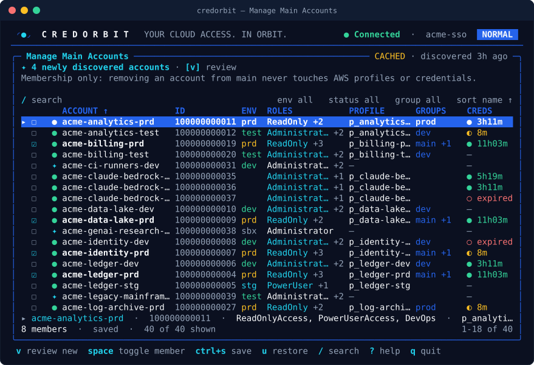

<h1> Account Groups</h1>

Main Accounts and custom groups: saved selections of accounts that you use as export scopes, from the CLI or the terminal UI.

[← Back to README](../README.md) · [Docs index](README.md)

---

> [!NOTE]
> Groups only live in `config.yaml`. Creating, editing or deleting a group never creates, changes or deletes AWS profiles or credentials.

## Concepts

| Term | Meaning |
|---|---|
| **Main Accounts** | The built-in `main` group. It always exists, cannot be renamed or deleted (only emptied), and is the default scope of `credorbit setup` when it has members |
| **Custom group** | Any other group, for example `dev`, `prod` or `team.payments`. Names use lowercase letters, digits, `.`, `_` and `-` (64 characters at most) |
| **Member** | An account, stored by its 12-digit account ID, plus optionally its profile name and a role |
| **Temporary selection** | `--accounts a,b` (CLI) or "Select Accounts Manually" (TUI): a scope for one run that never changes a group |

## Member status

Every member is shown with a status, computed from the latest discovery (live or cached) and your `~/.aws/config`:

| Status | Meaning | What happens on export |
|---|---|---|
| `available` | Visible in SSO and configured as a profile | Exported |
| `new` | Visible in SSO, but no profile yet | Skipped until `sync` adds the profile |
| `missing` | No profile configured for this member (any more) | Skipped with a warning |
| `unknown` | Discovery failed or was incomplete, so status cannot be decided | Exported if a profile exists |

## CLI workflows

```sh
credorbit groups list                                  # name, member count, description
credorbit groups show main                             # members with ID, profile, role, status
credorbit groups add main 111111111111 p_acme-billing-prd
credorbit groups remove main p_acme-billing-prd
credorbit groups create prod --description "Production accounts"
credorbit groups rename prod production
credorbit groups delete production                     # main can only be emptied
credorbit groups edit main                             # opens the TUI editor (interactive terminal)
```

Keys can be an account ID or a profile name, with or without the profile prefix (`acme-billing-prd` finds `p_acme-billing-prd`). Unknown keys are rejected and nothing is changed.

### Use a group as a scope

| Command | Scope |
|---|---|
| `credorbit export --group main` | Main Accounts |
| `credorbit export --group dev` | A custom group |
| `credorbit setup --group prod` | Full Setup & Sync limited to a group |
| `credorbit sync --group dev` | Add profiles only for the group's new accounts |
| `credorbit groups sync dev` | Sync the group's accounts, then export the group |
| `credorbit accounts list --group dev` | Inventory filtered to a group |
| `credorbit export --accounts 111111111111,p_acme-dev` | Temporary selection, no group changed |

`--all`, `--group`, `--profile` and `--accounts` are mutually exclusive.

> [!TIP]
> `credorbit setup` without a scope flag uses Main when it has members and every prefixed profile otherwise. Fill Main once and your daily `setup` stays fast.

## TUI workflows

| Screen | Open with | What you can do |
|---|---|---|
| Manage Main Accounts | Main menu item 5, or `credorbit ui --screen main` | Toggle members, review new accounts, choose a role per account, save |
| Manage Account Groups | Main menu item 6, or `credorbit ui --screen groups` | Create (`c`), rename (`r`), delete (`d`) and edit (`enter`) groups |
| Group editor | `enter` on a group, or `credorbit groups edit NAME` | Same editor as Main |

<div align="center">
  
  <br><sub>The Main Accounts editor (demo data)</sub>
</div>

### Editor keys

| Key | Action |
|---|---|
| `space` | Toggle the account under the cursor |
| `a` / `n` / `i` | Select all / none / invert (visible rows) |
| `ctrl+s` | Save the membership |
| `u` | Restore the last saved selection |
| `enter` | Choose the preferred role for the account |
| `v` | Review newly discovered accounts (shown when there are any) |
| `/` | Search by name, ID or profile |
| `e` / `s` / `g` | Cycle the environment / status / group filter |
| `o` / `O` | Cycle the sort column / reverse the order |
| `c` | Clear search and filters |
| `r` | Refresh discovery |
| `esc` | Back; asks before discarding unsaved changes |

Changes in the editor are pending until you press `ctrl+s`.

## New accounts

When discovery finds accounts that have no profile yet:

| Where | What happens |
|---|---|
| `credorbit sync` / `setup` | A profile `<prefix><account name>` is proposed for each new account (role: your preferred role, the only assigned role, or, with several roles, one you pick; non-interactive runs skip accounts with several roles and tell you to use `credorbit roles set`) |
| `credorbit setup` (interactive, Normal mode) | You are asked which new accounts to add to Main |
| `credorbit setup` (non-interactive or `--dry-run`) | New accounts are left ungrouped and reported |
| `credorbit setup --edit-main` with an empty Main | You choose the whole Main group from the discovered accounts |
| Script-compatible mode | New accounts are included in that run's Main export (`export.include_new_in_main`), without being saved to the group |
| TUI group editor | A banner offers **Review & select**, **Add all to Main** (pending until `ctrl+s`), **Add to another group** (saved immediately) or **Keep ungrouped** |

## Missing accounts

When an account disappears from SSO, CredOrbit keeps it in your groups and flags it:

- The member's status becomes `missing` once its profile is gone, and exports skip it with a warning naming the group and member.
- Profile removal is a separate, reviewed step (`credorbit sync --remove-stale`), and only for profiles with the CredOrbit prefix. It is blocked when discovery is incomplete or cached, or when fewer than `sync.threshold` (80 %) of your configured accounts were discovered.
- Removing the member from the group is up to you: `credorbit groups remove main 111111111111`.

> [!IMPORTANT]
> CredOrbit never deletes a profile because of a group change, and never removes group members on its own.

## Storage format

```yaml
groups:
  main:
    description: Accounts exported in main mode
    members:
      - account_id: "111111111111"
        profile: p_acme-billing-prd
  dev:
    description: Development accounts
    members:
      - account_id: "222222222222"
      - profile: p_acme-sandbox   # profile-only member, account ID unknown
```

Members are sorted when saved, so diffs stay small. See [CONFIGURATION.md](CONFIGURATION.md#keys-edited-by-other-commands).
