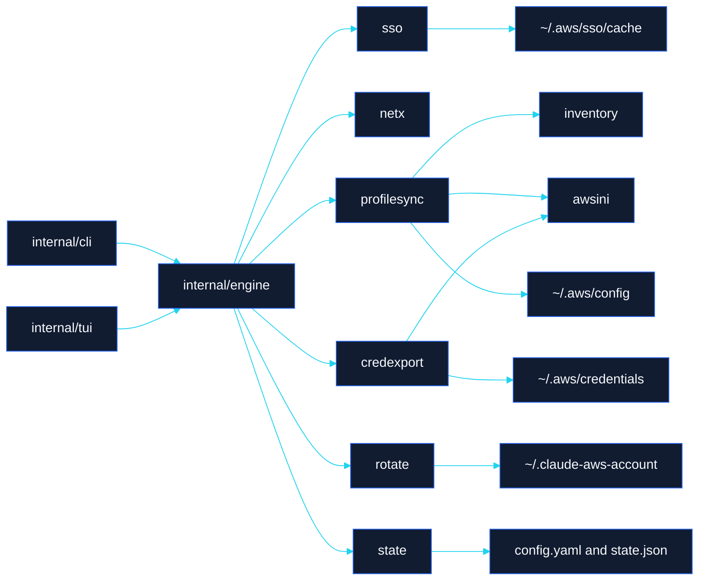
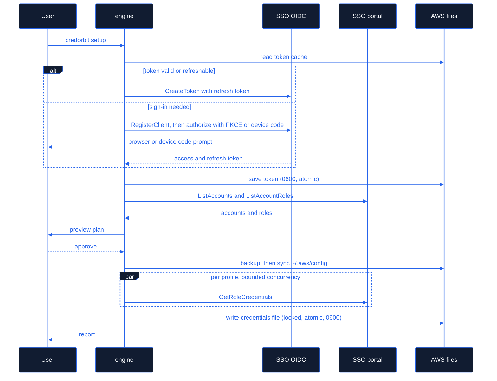

<h1> Architecture</h1>

Packages, contracts and data flow of CredOrbit, and the guarantees every file write follows.

[← Back to README](../README.md) · [Docs index](README.md)

---

CredOrbit is a single static Go binary. It talks to AWS IAM Identity Center (SSO)
directly through the AWS SDK for Go v2 — no AWS CLI, Bash, Python or curl needed.
The CLI (Cobra) and the TUI (Bubble Tea) are two thin front-ends over **one**
service layer (`internal/engine`), so every interactive action has a scriptable
equivalent and both behave identically.

```
                ┌──────────────┐    ┌──────────────┐
                │ internal/cli │    │ internal/tui │   front-ends (no business logic)
                └──────┬───────┘    └──────┬───────┘
                       └────────┬──────────┘
                         ┌──────▼──────┐
                         │   engine    │  workflows: setup --full, sync, export,
                         └──────┬──────┘  rotate, groups, status, doctor
   ┌────────┬────────┬─────────┼─────────┬──────────┬─────────┬──────────┐
   │  sso   │ netx   │ awsini  │inventory│profilesync│credexport│ rotate │
   │ oidc+  │ CA/    │ round-  │ status  │ plan/apply│ fetch +  │ claude │
   │ portal │ proxy  │ trip INI│ + stale │ config    │ write    │ bedrock│
   └────────┴────────┴─────────┴─────────┴──────────┴─────────┴──────────┘
   state (config.yaml + state.json, groups)   roles (ranking/policies)
   importer (legacy script, read-only)        fsutil · paths · redact · model
   brand · version · update (release check)
```



### Login, discovery and export



## Design principles

1. **Nothing organization-specific is compiled in.** Accounts, roles, sessions,
   start URLs, CA paths, default-profile mapping and rotation lists come from live
   SSO discovery, the user's AWS config, CredOrbit's settings, or an optional
   one-time import of the legacy script.
2. **Discovery failure ≠ revoked access.** Only a *complete* discovery may mark
   an account `missing`. `ErrNoAccess` (ForbiddenException) is the sole signal of
   revocation; throttling/5xx/TLS errors are `ErrTransient` and retried.
3. **Never lose working files.** All writes: lock → re-read → modify in memory →
   validate by re-parsing → timestamped backup → same-directory temp file → fsync
   → atomic rename → restrictive permissions (0600 / owner-only DACL).
4. **Own only what we created.** Unrelated profiles, comments, and credential
   sections are preserved byte-for-byte. Credential sections CredOrbit writes are
   recorded in `state.json` (`managed_sections`) and only those may be pruned.
5. **No silent privilege changes.** Normal mode uses the configured role. Role
   ranking (strongest/script) is opt-in; persisting a different role to
   `~/.aws/config` requires approval (or `--yes` / config `roles.update_config`).
6. **Secrets never leave memory except into the credentials file / token cache.**
   `model.Credentials` / `model.Token` have redacting `String()`; the slog handler
   in `redact` scrubs every record; tokens are never passed as process args.

## Packages and contracts

All packages live under `internal/`. `model`, `fsutil`, `paths` and `redact` are the
shared foundation.

### model — shared types
`SSOSession, Account, DiscoveredAccount, Discovery, Profile, AccountStatus,
RolePolicy, Credentials, Token, Event/Reporter`, error classes
`ErrNoAccess, ErrUnauthorized, ErrTransient, ErrNotFound, ErrCanceled`.

### fsutil
`AtomicWrite(path, data, perm)`, `WriteIfChanged`, `Backup(path, keep) (string, error)`,
`ListBackups(path)`, `ReadFileOptional`, `ExpandHome`, `Restrict(path, perm)`,
`CheckPrivate(path) (ok bool, detail string, err error)`,
`AcquireLock(target, timeout) (*Lock, error)` / `(*Lock).Release()`, `ErrLocked`.

### paths
`Resolve() (Paths, error)` → `AWSConfig, AWSCredentials, SSOCacheDir, AppConfigDir,
AppConfigFile, AppStateFile, AppLogFile, ClaudeAccountFile, LegacyScript`.
Honors `AWS_CONFIG_FILE`, `AWS_SHARED_CREDENTIALS_FILE`, `CREDORBIT_CONFIG_DIR`, `XDG_CONFIG_HOME`.

### redact
`String(s) string`, `NewHandler(slog.Handler) *Handler`.

### netx — TLS, CA and proxy
```go
type Options struct {
    CABundle   string   // explicit bundle; if empty and AWS_CA_BUNDLE is set, that is used
    ExtraCAs   []string // additional PEM files APPENDED to the system pool
    Timeout    time.Duration
}
type Info struct { CASources []string; Proxy string /* redacted userinfo */; SystemPool bool }
func NewHTTPClient(o Options) (*http.Client, Info, error)
// System roots + extra CAs, so ONE client works on and off a TLS-intercepting
// network (SASE) — no toggling needed. TLS ≥1.2, proxy from environment
// (HTTPS_PROXY/NO_PROXY), InsecureSkipVerify is never set.

type ProbeResult struct {
    URL string; OK bool; Intercepted bool  // leaf chain not issued by a public Amazon CA
    Issuer string; Subject string; ChainSubjects []string
    ErrClass string // "", "unknown_authority", "proxy", "dns", "timeout", "tls", "http"
    Err string; Advice string
}
func Probe(ctx context.Context, c *http.Client, url string) ProbeResult
func ProbeWithSystemOnly(ctx context.Context, url string) ProbeResult
func WriteCombinedBundle(dst string, extra []string) (int, error) // system PEM file + extras for the AWS CLI / child processes
```

### sso — IAM Identity Center
```go
type Client interface {
    ListAccounts(ctx context.Context, accessToken string) ([]model.Account, error)            // all pages
    ListAccountRoles(ctx context.Context, accessToken, accountID string) ([]string, error)   // all pages
    GetRoleCredentials(ctx context.Context, accessToken, accountID, role string) (model.Credentials, error)
}
func NewClient(region string, hc *http.Client) Client    // SDK-backed, retry+backoff, errors mapped to model.Err*

type TokenCache struct{ Dir string } // AWS CLI v2 compatible (~/.aws/sso/cache)
func (c TokenCache) Load(s model.SSOSession) (model.Token, error)  // file sha1(session name).json; legacy: sha1(start URL)
func (c TokenCache) Save(s model.SSOSession, t model.Token) error  // atomic, 0600

type Flow string // "browser" (auth code + PKCE on loopback) | "device"
type Prompt struct{ VerificationURL, UserCode string }
type Authenticator struct {
    HTTP *http.Client; Cache TokenCache
    OpenBrowser func(url string) error    // nil → print only
    OnPrompt    func(Prompt)              // shown to user (never contains tokens)
    Now         func() time.Time
}
func (a *Authenticator) Login(ctx context.Context, s model.SSOSession, f Flow) (model.Token, error)
func (a *Authenticator) Valid(ctx context.Context, s model.SSOSession) (model.Token, error) // load; refresh via refresh_token if expired; ErrUnauthorized if impossible
func (a *Authenticator) Logout(ctx context.Context, s model.SSOSession) error

func Discover(ctx context.Context, c Client, tok model.Token, s model.SSOSession, concurrency int, rep model.Reporter) *model.Discovery
// ListAccounts failure → Complete=false, Err set, Accounts empty.
// Per-account ListAccountRoles failure → that account's RolesErr set; Complete stays true.
```

### awsini — round-trip preserving INI for `~/.aws/config` and `~/.aws/credentials`
```go
type File struct{ /* lines, sections; preserves comments/blank lines/order/formatting */ }
func Parse(data []byte) (*File, error)
func (f *File) Bytes() []byte
func (f *File) Section(name string) *Section          // exact header text, e.g. "profile p_x", "sso-session s", "default"
func (f *File) Sections() []*Section
func (f *File) AddSection(name string) *Section       // appended at end with a blank separator
func (f *File) RemoveSection(name string) bool        // removes header + body + its leading comment block
type Section struct{ /* ... */ }
func (s *Section) Name() string
func (s *Section) Get(key string) (string, bool)
func (s *Section) Set(key, value string)              // updates in place, or appends
func (s *Section) Delete(key string) bool
func (s *Section) Keys() []string
// AWS helpers
func Profiles(f *File) []model.Profile                // every "[profile X]" with sso fields (+ "[default]" if SSO)
func SSOSessions(f *File) []model.SSOSession
func ProfileSectionName(profile string) string        // "default" → "default", else "profile "+name
```

### roles — ranking & policies
```go
type Rule struct{ Match string /* glob, case-insensitive */; Weight int }
type Ranker struct{ Rules []Rule }                    // lower weight = stronger
func DefaultRanker() Ranker                           // reproduces the script's ranking
func (r Ranker) Rank(role string) int
func (r Ranker) Sort(roles []string) []string         // strongest first, stable
type Request struct {
    Policy model.RolePolicy; Assigned []string; AssignedKnown bool
    Configured string; Manual string; Fallbacks []string
}
func Candidates(req Request, r Ranker) []string        // ordered roles to attempt; deduped
```
Policy semantics: `configured` → [Configured] (only if assigned or assignment unknown);
`manual` → [Manual]; `strongest` → ranked assigned; `readonly` → reverse-ranked
assigned; `script` → ranked assigned, then Configured, then Fallbacks (legacy).

### inventory — compare discovery with configuration
```go
type Item struct {
    Account  model.DiscoveredAccount
    Profiles []model.Profile          // configured profiles for this account in this session
    Status   model.AccountStatus
}
func Build(d *model.Discovery, profiles []model.Profile, session string) []Item
type StaleResult struct{ Stale []model.Profile; Blocked bool; Reason string }
func Stale(d *model.Discovery, profiles []model.Profile, session string, threshold float64) StaleResult
// Blocked when discovery is incomplete/cached, or len(discovered) < threshold * len(configured accounts) (default 0.8).
```

### profilesync — plan/apply changes to `~/.aws/config`
```go
type ChangeKind string // "add", "remove", "set-role"
type Change struct{ Kind ChangeKind; Profile model.Profile; OldRole string; Reason string }
type PlanOptions struct {
    Session string; Prefix string /* "p_" */; Region, Output string
    AddNew bool; RemoveStale bool; Threshold float64
    AccountFilter map[string]bool        // nil = all
    ChooseRole func(a model.DiscoveredAccount) string   // role for new profiles
    RoleUpdates map[string]string        // profile → new role (from successful exports)
}
type Plan struct{ Changes []Change; Warnings []string; StaleBlocked bool }
func BuildPlan(f *awsini.File, d *model.Discovery, o PlanOptions) *Plan
func (p *Plan) Preview() string                        // unified-diff-like, no secrets
func (p *Plan) Empty() bool
func Apply(configPath string, p *Plan, backupKeep int) (backup string, err error)
// lock, re-parse current file, apply onto it, validate re-parse, backup, atomic write
func ProfileName(prefix, accountName, accountID string, taken map[string]bool) string
// prefix + accountName with spaces/underscores/'+' → '-'; collision → append "-"+accountID
```

### credexport — fetch temporary credentials and write `~/.aws/credentials`
```go
type Target struct{ Profile model.Profile; Section string }    // section: "p_x" → "x" (compat) or profile name
type Fetcher interface {
    // tries candidates in order; returns the role that worked
    Fetch(ctx context.Context, p model.Profile, candidates []string) (model.Credentials, string, error)
}
func NewSSOFetcher(c sso.Client, tokens func(session string) (model.Token, error)) Fetcher
type Options struct {
    Concurrency int; Policy model.RolePolicy; Ranker roles.Ranker; Fallbacks []string
    Manual map[string]string               // accountID → role
    Assigned map[string][]string           // accountID → discovered roles (nil = unknown)
}
type Item struct{ Target Target; Role string; Expiration time.Time; Err error; creds model.Credentials }
type Result struct{ Items []Item }
func Fetch(ctx context.Context, targets []Target, f Fetcher, o Options, rep model.Reporter) *Result
func (r *Result) Succeeded() int
func (r *Result) RoleChanges() map[string]string      // profile → role used, where != configured
type WriteOptions struct {
    DefaultFrom string          // section to copy into [default]; "" = leave [default] alone
    Prune []string              // managed sections to delete (profiles removed)
    BackupKeep int
}
type WriteReport struct{ Written, Kept, Pruned []string; Backup string; Warnings []string }
func Write(path string, r *Result, o WriteOptions) (*WriteReport, error)
// lock; parse existing; replace ONLY succeeded sections; failed targets keep their old
// section; unrelated sections untouched; refuse (error) if zero succeeded; atomic, 0600.
func SectionName(profile, prefix string, stripPrefix bool) string
func ReadExpirations(path string) map[string]time.Time // from x_credorbit_expiration keys (written by Write)
```

### state — settings, groups and cached state
`config.yaml` (user settings, versioned, migrated) and `state.json` (machine
state: discovery cache, managed sections, last-used roles, rotation history). No
secrets are ever stored in either.
```go
type Config struct {
    Version int                     `yaml:"version"`
    Mode string                     `yaml:"mode"`            // "normal" | "compat"
    SSO SSOConfig                   // DefaultSession, LoginFlow ("browser"|"device")
    Profiles ProfilesConfig         // Prefix "p_", Region, Output
    Groups map[string]*Group        // "main" + user-defined
    Accounts map[string]AccountPref // accountID → {Profile, Role (preferred/manual)}
    Roles RolesConfig               // Policy, Fallbacks, Ranking []RankRule{Match, Weight}, UpdateConfig bool
    Sync SyncConfig                 // AddNew bool, RemoveStale "never"|"prompt", Threshold 0.8
    Export ExportConfig             // Enabled, CredentialsFile, StripPrefix, DefaultProfile, Concurrency, BackupKeep, IncludeNewInMain
    Rotation RotationConfig         // Target "claude", File, Accounts []string, Strategy, VerifyBedrock, BedrockRegion, BedrockModel
    Network NetworkConfig           // CABundle, ExtraCAs []string, ProbeURL, CombinedBundlePath string
    UI UIConfig                     // Theme "default"|"light"|"mono", ASCII bool
    Update UpdateConfig             // Repo "owner/name", Check bool
}
type Group struct{ Name, Description string; Members []Member }
type Member struct{ AccountID, Profile, Role string } // stable key: AccountID (+Profile)
func Default() *Config
func Load(path string) (*Config, error)          // missing file → Default(); migrates old versions
func (c *Config) Save(path string) error         // atomic, 0600
func (c *Config) Validate() error
// groups
func (c *Config) Group(name string) (*Group, error)
func (c *Config) EnsureGroup(name, desc string) *Group
func (c *Config) DeleteGroup(name string) error  // "main" cannot be deleted, only emptied
func (c *Config) RenameGroup(oldName, newName string) error // "main" cannot be renamed
func (g *Group) Add(m Member) bool; func (g *Group) Remove(key string) bool  // key = accountID or profile
func (g *Group) Has(key string) bool
type State struct {
    Discoveries map[string]*model.Discovery // by session
    ManagedSections []string
    LastRole map[string]string               // profile → role last used successfully
    LastRun time.Time
    Rotation RotationState                   // Current, History
}
func LoadState(path string) (*State, error); func (s *State) Save(path string) error
```

### importer — one-time, read-only import of the legacy script
```go
type Legacy struct {
    MainProfiles, ClaudeRotation, FallbackRoles []string
    SSOSession, DefaultProfile, SASECA, ProbeURL, CredsFile, Prefix, RotationFile string
    Parallel int
    Warnings []string
}
func ParseScript(data []byte) (*Legacy, error)   // reads bash arrays/defaults at runtime; nothing compiled in
func (l *Legacy) Apply(c *state.Config, profiles []model.Profile) []string // returns notes; maps names→account IDs
func CompatDefaults(c *state.Config, l *Legacy) // switch to Script-compatible behaviour
```

### rotate — Claude Code / Bedrock account rotation
```go
type Strategy string // "random" | "round-robin" | "manual"
func Next(current string, eligible []string, s Strategy, rnd *rand.Rand) (string, error)
// 0 eligible → error; 1 → that account (no loop); random never repeats current when alternatives exist
func ReadCurrent(path string) (string, error); func WriteCurrent(path, account string) error
func Eligible(accounts []string, credsPath string, now time.Time) (ok []string, skipped map[string]string)
func VerifyBedrock(ctx context.Context, hc *http.Client, c model.Credentials, region, model string) error
func ShellIntegration(shell string, file string) (string, error) // zsh|bash|fish|powershell
```

### engine — workflows shared by CLI and TUI
Owns configuration, AWS files and SSO clients and implements `engine.Service`,
the single interface both front-ends use: sessions and login (`Sessions`,
`LoginStatus`, `Login`, `Logout`, `AddSession`), discovery (`Discover`,
`CachedDiscovery`, `Accounts`), `PlanSync` / `ApplySync`, `Export`, `RunFull`,
groups (`Groups`, `Group`, `CreateGroup`, `GroupAdd`, `GroupSet`, …), rotation
(`Rotation`, `Rotate`, `SetRotationAccounts`, `ShellIntegration`), `Status`,
`Doctor`, settings (`Settings`, `SetSetting`, `SetMode`), `ImportLegacy` and
`CheckUpdate`. Progress is emitted as `model.Event`s to a `Reporter`. User
decisions go through an `Interaction` interface (`Confirm`, `ReviewPlan`,
`SelectAccounts`, `SelectRole`, `LoginPrompt`) implemented by the CLI (line
prompts; `--yes` approves plan reviews but never destructive changes, which need
`--allow-remove`; non-TTY declines) and by the TUI (dialogs).

`RunFull` runs these steps in order: `environment`, `session`, `network`,
`login`, `discover`, `roles`, `compare`, `safeguards`, `main-group`, `scope`,
`role-policy`, `preview`, `approve` (a dry run stops here), `backup`, `sync`,
`credentials`, `export`, `role-updates`, `rotate`, `validate`, `report`.

### brand, version, update
`brand` holds the palette and the terminal mark (Unicode and ASCII) plus colour /
Unicode detection (`NO_COLOR`, `CLICOLOR_FORCE`, `CREDORBIT_ASCII`, locale).
`version` resolves the build version (link-time `-X` or Go build info). `update`
queries the GitHub releases API for `update.repo`; it only reports, never installs.

### cli, tui
Cobra commands map 1:1 to engine methods. `credorbit` with no args (on a TTY)
and `credorbit ui` open the Bubble Tea UI; on a non-TTY `credorbit` prints help.
The TUI also ships a fake in-memory `Service` (`internal/tui/demo`) used by
`credorbit ui --demo`, tests and `tui.RenderStatic` (documentation screenshots).
Exit codes: 0 ok, 1 error, 2 usage, 3 partial, 4 needs login, 130 cancelled.

## Files written

| File | Writer | Safety |
|------|--------|--------|
| `~/.aws/config` | profilesync | lock, backup, validate, atomic, perms preserved/0600 |
| `~/.aws/credentials` | credexport | lock, backup, never empty, unrelated preserved, 0600 |
| `~/.aws/sso/cache/*.json` | sso | atomic, 0600, AWS CLI compatible (token; `credorbit-client-*.json` OIDC registration) |
| `~/.claude-aws-account` | rotate | atomic, 0600 |
| `<config dir>/config.yaml`, `state.json` | state | atomic, 0600, no secrets |
| `<config dir>/credorbit.log` | engine | 0600, JSON, redacted, rotated at 5 MB |
| `<file>.credorbit-<timestamp>.bak` | fsutil | 0600, newest `export.backup_keep` kept |
