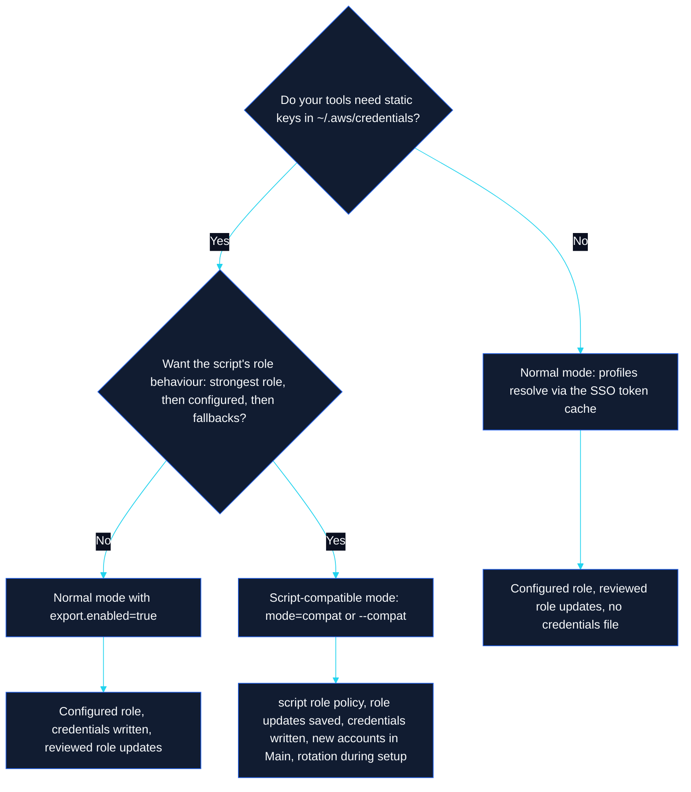

<h1> Migrating from populate-aws-creds.sh</h1>

Move from the legacy Bash script to CredOrbit in a few minutes, keep the behaviour you rely on, and roll back at any time.

[← Back to README](../README.md) · [Docs index](README.md) · [Feature-parity matrix](MIGRATION_MATRIX.md)

---

> [!NOTE]
> CredOrbit never modifies or deletes the legacy script. `credorbit import` only reads it, so you can keep running the script while you evaluate CredOrbit.

## At a glance

| Step | Command | Writes |
|---|---|---|
| 1. Install | see [INSTALLATION.md](INSTALLATION.md) | the binary |
| 2. Import settings | `credorbit import` | `config.yaml` (after you approve the preview) |
| 3. Check | `credorbit doctor` · `credorbit config list` · `credorbit groups show main` | nothing |
| 4. Preview a run | `credorbit setup --compat --dry-run` | nothing |
| 5. Run | `credorbit setup --compat` | AWS config, credentials, rotation file (reviewed) |
| 6. Optional | `credorbit config set mode compat` to make it permanent | `config.yaml` |

## 1. Import the script's settings

```sh
credorbit import                                   # reads ~/populate-aws-creds.sh
credorbit import --script ~/bin/populate-aws-creds.sh
credorbit import --compat                          # also switch to Script-compatible mode
```

CredOrbit parses the script's arrays and `${VAR:-default}` assignments at runtime and shows a preview of every change before writing `config.yaml`. Nothing from the script is compiled into CredOrbit, and anything it cannot find stays empty rather than guessed.

| In the script | Becomes | Notes |
|---|---|---|
| `MAIN_PROFILES=( … )` | Members of the Main group | Each profile must exist in `~/.aws/config`; missing ones are listed and skipped; duplicates ignored |
| Common `<x>_` prefix of `MAIN_PROFILES` | `profiles.prefix` | Only when every entry shares it |
| `CLAUDE_ROTATION=( … )` | `rotation.accounts` | Credentials section names |
| `CLAUDE_ACCT_FILE=…` | `rotation.file` | Only when it differs from `~/.claude-aws-account` |
| `FALLBACK_ROLES="${FALLBACK_ROLES:-…}"` | `roles.fallbacks` | Space-separated list |
| `SSO_SESSION="${SSO_SESSION:-…}"` | `sso.default_session` | Only if no default session is set yet |
| `SASE_CA="${SASE_CA:-…}"` | `network.extra_cas` | Only if the PEM file exists; appended to the system roots |
| First `https://` URL on a `curl` line | `network.probe_url` | Prefers the line using `--cacert` |
| `CREDS_FILE="${CREDS_FILE:-…}"` | `export.credentials_file` | Only when it is not `~/.aws/credentials` |
| `PARALLEL="${PARALLEL:-…}"` | `export.concurrency` | Clamped to 1–64 |
| `export_section <profile> default` | `export.default_profile` | Profile copied to `[default]` |

> [!TIP]
> In a non-interactive shell the preview is shown but not applied. Re-run with `--yes` to apply it: `credorbit import --yes`. Importing the same script twice changes nothing the second time.

## 2. Check the result

```sh
credorbit config list          # imported values
credorbit groups show main     # Main Accounts, with status per member
credorbit rotate --list        # rotation accounts and eligibility
credorbit doctor               # AWS config, SSO, TLS, permissions, rotation file
```

## 3. Choose a mode



| Behaviour | Normal mode | Script-compatible mode |
|---|---|---|
| Role tried | Profile's `sso_role_name` (or preferred role) | Assigned roles strongest first, configured role, fallbacks |
| Save the role that worked to `~/.aws/config` | After review (`--update-roles`) | Automatically |
| Write `~/.aws/credentials` | Only with `export.enabled=true` | Yes |
| Section names `p_x` → `[x]` | Yes | Yes |
| Newly discovered accounts in a Main run | Offered for review in the TUI and interactive CLI | Included for that run |
| Rotate Claude account during `setup` | Only with `--rotate` | Yes, when rotation accounts are configured |
| Stale profile removal | Reviewed | Reviewed |

Use `--compat` for single runs while evaluating; make it permanent with `credorbit config set mode compat`.

## 4. Map your old commands

| Legacy | CredOrbit |
|---|---|
| `./populate-aws-creds.sh` (all `p_*` profiles) | `credorbit setup --compat --all` |
| `./populate-aws-creds.sh main` | `credorbit setup --compat --group main` (Main is also the default scope when it has members) |
| `./populate-aws-creds.sh p_acme-dev` | `credorbit export --compat --profile p_acme-dev` |
| `FORCE_LOGIN=1 ./populate-aws-creds.sh` | `credorbit setup --compat --force-login` (or keep `FORCE_LOGIN=1`) |
| `SYNC=0 ./populate-aws-creds.sh` | `credorbit setup --compat --no-sync` (or keep `SYNC=0`) |
| `PARALLEL=20 ./populate-aws-creds.sh` | `credorbit setup --compat --parallel 20` (or keep `PARALLEL=20`) |
| `SASE_CA=none ./populate-aws-creds.sh` | `credorbit setup --compat --no-extra-ca` |
| `aws sso login` | `credorbit login` |

The environment variables `SSO_SESSION`, `FORCE_LOGIN`, `PARALLEL`, `CREDS_FILE`, `SYNC`, `ROLE_UPDATE`, `FALLBACK_ROLES` and `AWS_CA_BUNDLE` are still honoured for the run they are set in. See [CONFIGURATION.md](CONFIGURATION.md#environment-variables).

## 5. Preview, then run

```sh
credorbit setup --compat --dry-run    # every step up to the preview; writes nothing
credorbit setup --compat              # asks before applying the plan
```

For cron or CI, approve the plan with `--yes`. Stale-profile removals need their own approval:

```sh
credorbit setup --compat --yes                  # applies additions, role updates, export, rotation
credorbit setup --compat --yes --allow-remove   # also removes stale profiles (still behind the safeguards)
```

> [!WARNING]
> The script removed stale profiles automatically. CredOrbit never does: `--yes` declines removals, and they are blocked entirely when discovery is incomplete, cached, or finds fewer than 80 % of your configured accounts.

## What changes for you

| Area | Legacy script | CredOrbit |
|---|---|---|
| Main profiles and rotation accounts | Arrays in the script, which rewrites its own source | `config.yaml`; edit with `credorbit groups` / `credorbit rotate accounts` or the TUI |
| Credentials file | Rewritten with only the processed profiles | Only processed sections replaced; other sections preserved; failed profiles keep their old credentials |
| Backups | One rolling `config.bak` | Timestamped `*.credorbit-<timestamp>.bak`, newest 5 kept |
| Login check | `sts get-caller-identity` on one hardcoded profile | Token expiry from the cache, silent refresh |
| Corporate CA | Used instead of the system roots | Appended to the system roots, works on and off the corporate network |
| Rotation file | `~/.claude-aws-account` | Same file and format, so your shell integration keeps working |
| Dependencies | Bash, AWS CLI, Python, `curl` | None |

The full list, including the legacy defects that were fixed, is in the [feature-parity matrix](MIGRATION_MATRIX.md).

## Rollback

CredOrbit's changes are reversible at every step:

| To undo | Do |
|---|---|
| Script-compatible mode | `credorbit config set mode normal` (restores `roles.policy=configured`, `roles.update_config=false`, `export.enabled=false`) |
| A change to `~/.aws/config` or the credentials file | Copy the newest `*.credorbit-*.bak` backup over the file |
| The import | Delete or edit `config.yaml` (`credorbit config path`), or point `CREDORBIT_CONFIG_DIR` at an empty directory |
| CredOrbit entirely | Run the legacy script again; it was never modified. Profiles CredOrbit added are ordinary AWS CLI profiles |
