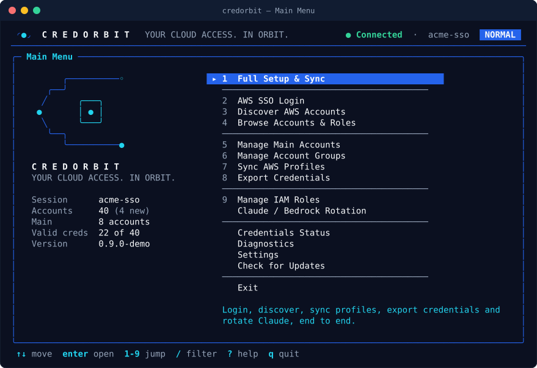

# CredOrbit documentation

**Your Cloud Access. In Orbit.**

[← Back to README](../README.md)

---

## Start here

| Guide | What you'll learn |
|---|---|
| 🚀 [User Guide](USER_GUIDE.md) | First run, Full Setup & Sync step by step, daily workflow, automation with `--yes`, `--json` and exit codes |
| 📦 [Installation](INSTALLATION.md) | Install scripts, release archives, `go install`, building from source, completions, checksums, uninstall |
| 🖥️ [Terminal UI Guide](TUI_GUIDE.md) | Every screen and key binding, demo mode, themes, `NO_COLOR` and ASCII |

## Reference

| Guide | What you'll learn |
|---|---|
| ⚙️ [Configuration](CONFIGURATION.md) | Every `config.yaml` key with its default, role policies, environment overrides, file locations |
| ⭐ [Account Groups](ACCOUNT_GROUPS.md) | Main Accounts and custom groups from the CLI and TUI; new and missing accounts |
| 🩺 [Troubleshooting](TROUBLESHOOTING.md) | Symptoms, causes and fixes; exit codes |
| 🛡️ [Security](SECURITY.md) | Threat model, what is written where, redaction, reporting vulnerabilities |
| 🧩 [Architecture](ARCHITECTURE.md) | Packages, contracts, data flow and file-safety guarantees |

## Migrating

| Guide | What you'll learn |
|---|---|
| 🔁 [Migration](MIGRATION.md) | Import the legacy `populate-aws-creds.sh`, Script-compatible mode, command mapping, rollback |
| 📋 [Migration matrix](MIGRATION_MATRIX.md) | Feature-by-feature parity with the legacy script and the defects that were fixed |

## Project

| | |
|---|---|
| [Changelog](../CHANGELOG.md) | Release notes |
| [Brand guidelines](../assets/brand/BRAND.md) | Logo, palette, typography |
| [Commercial licensing](../COMMERCIAL.md) | Free for personal, educational, research and non-profit use; companies need a paid license |

  

