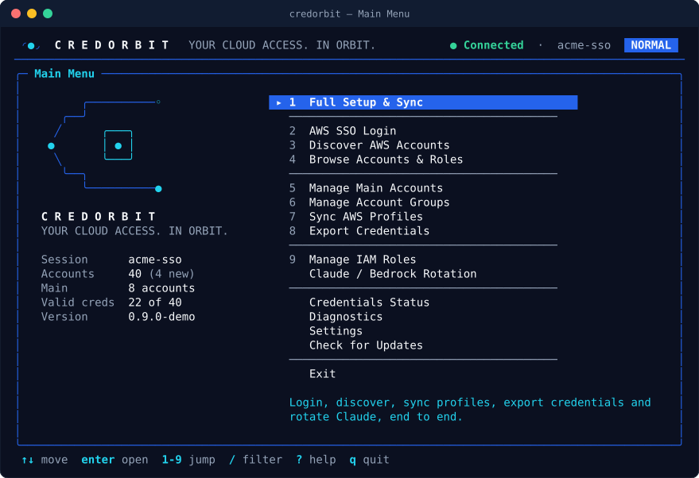
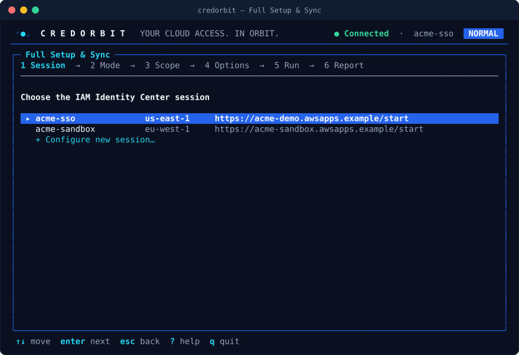
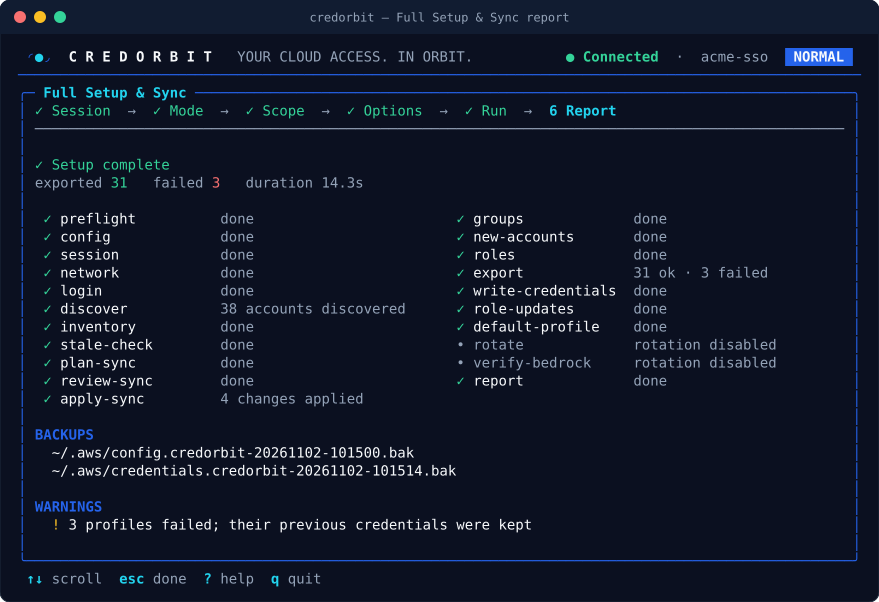
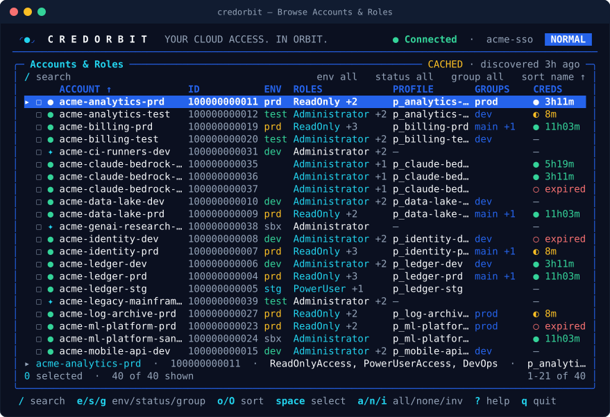
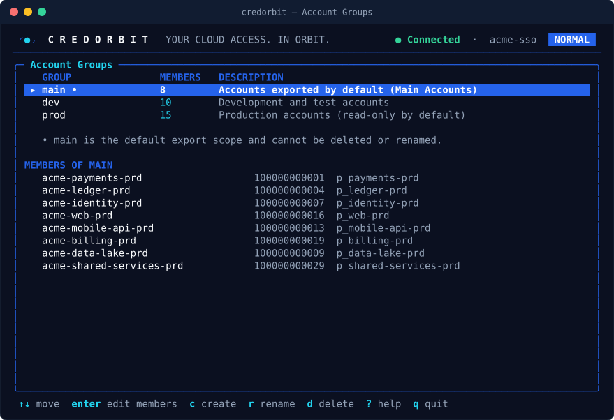
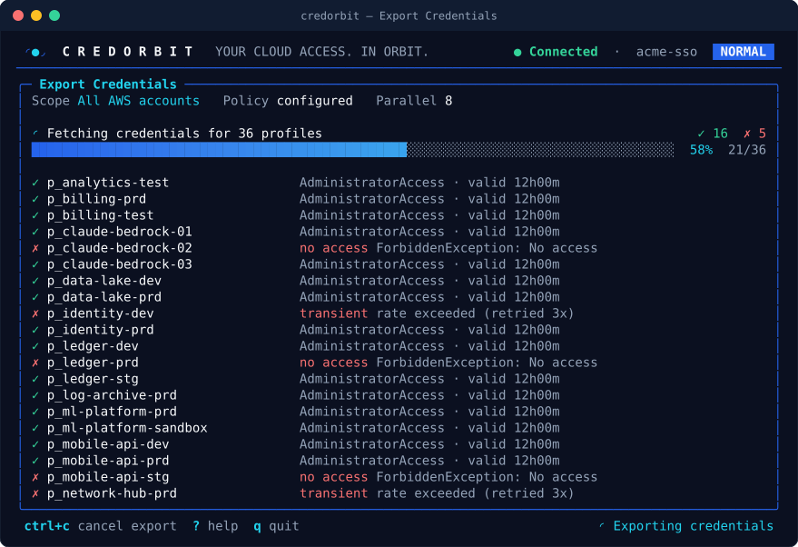
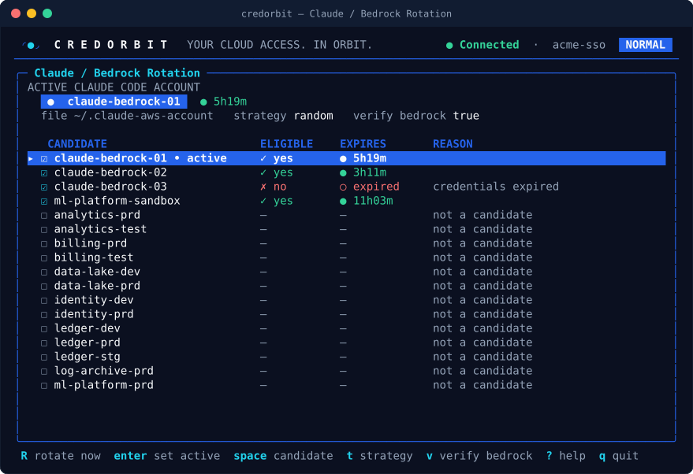

<h1> Terminal UI Guide</h1>

Every screen of the CredOrbit terminal UI, its key bindings, demo mode, and colour and ASCII options.

[← Back to README](../README.md) · [Docs index](README.md)

---

## Opening the UI

| Command | Opens |
|---|---|
| `credorbit` | The main menu (on an interactive terminal; otherwise help is printed) |
| `credorbit ui` | The main menu |
| `credorbit ui --screen setup` | Straight into a screen: `setup`, `main`, `groups`, `accounts` or `rotate` |
| `credorbit groups edit dev` | The editor for one group |
| `credorbit ui --demo` | Demo mode with fake `acme-*` data: no AWS calls, no file writes |

> [!TIP]
> `credorbit ui --demo` is the safest way to learn the UI. It works without an AWS config or SSO session.

The UI needs at least 50 × 15 characters; a smaller terminal shows "Terminal too small".

## Layout

<div align="center">
  
</div>

| Area | Shows |
|---|---|
| Header | Brand mark, login state (for example **Connected**), active SSO session, mode badge (`NORMAL` or `COMPAT`) |
| Panel | The current screen; its title becomes a breadcrumb when you open sub-screens. A badge such as **CACHED · discovered 3h ago** marks offline data |
| Footer | The keys for this screen, `?` help and `q` quit, plus the running operation |

Long operations run in the background with live progress. Decisions the engine needs (plan reviews, confirmations, role choices, the SSO sign-in prompt) appear as dialogs.

## Global keys

| Key | Action |
|---|---|
| `↑` `↓` / `k` `j` | Move |
| `enter` | Open / confirm |
| `esc` | Back / cancel (asks first when there are unsaved changes) |
| `?` | Toggle the key help for the current screen; any key closes it |
| `q` | Quit; asks first while an operation is running |
| `ctrl+c` | Cancel the running operation; press again to force quit. Quits when nothing is running |

Files are only ever replaced atomically, so cancelling or quitting never leaves a half-written file.

## Main menu

| # | Item | Purpose |
|---|---|---|
| 1 | Full Setup & Sync | Login, discover, sync profiles, export credentials and rotate Claude, end to end |
| 2 | AWS SSO Login | Sign in (browser or device code) and refresh the token |
| 3 | Discover AWS Accounts | List every assigned account and role and compare with your AWS config |
| 4 | Browse Accounts & Roles | Search, filter and inspect accounts, roles, profiles, groups and credential expiry |
| 5 | Manage Main Accounts | Choose the accounts in the Main group |
| 6 | Manage Account Groups | Create, rename and edit custom groups |
| 7 | Sync AWS Profiles | Preview and apply profile additions, role updates and reviewed stale removals |
| 8 | Export Credentials | Fetch temporary credentials with live progress |
| 9 | Manage IAM Roles | Preferred role per account and the role policy |
| | Claude / Bedrock Rotation | Active Claude Code account, rotation and candidates |
| | Credentials Status | Sessions, exported sections and expiry |
| | Diagnostics | The same checks as `credorbit doctor` |
| | Settings | Every `config.yaml` setting |
| | Check for Updates | Compares with the latest release; never installs |
| | Exit | Leave CredOrbit |

| Key | Action |
|---|---|
| `↑` `↓` / `k` `j` / `tab` | Move (wraps around) |
| `home` `g` / `end` `G` | First / last item |
| `1`–`9` | Open item 1–9 directly |
| `/` | Filter items by name; `enter` opens the match, `esc` clears |
| `enter` / `space` | Open |

## Full Setup & Sync

<div align="center">
  
</div>

A six-step wizard: **Session → Mode → Scope → Options → Run → Report**.

| Step | What you choose | Keys |
|---|---|---|
| Session | An SSO session from `~/.aws/config`, or **Configure new SSO session** (name, start URL, region; the write is shown for approval) | `↑` `↓`, `enter` |
| Mode | Normal or Script-compatible for this run | `↑` `↓` / `tab`, `enter` |
| Scope | All AWS Accounts, Main Accounts (default), Custom Group, Select Accounts Manually, Single Account | `↑` `↓`, `enter` |
| Options | Toggles (below) | `space` / `enter` toggle, `enter` on **Start** or `s` starts |
| Run | Live step list and export progress | `ctrl+c` cancels |
| Report | Steps, counts, backups and warnings | `↑` `↓` scroll, `enter` / `esc` done |

| Option | Default | Effect |
|---|---|---|
| Export credentials | on | Write the credentials file |
| Update roles in ~/.aws/config | on in Script-compatible mode | Persist the role that worked (reviewed) |
| Rotate Claude / Bedrock account | on in Script-compatible mode when rotation accounts exist | Pick the next eligible account |
| Remove stale profiles (reviewed) | off | Off: you are asked separately before any removal. On: removals listed in the approved plan are applied without a second question |
| Dry run | off | Stop after the preview; write nothing |

The plan preview always opens as a dialog before anything is written (`a` / `y` / `enter` apply, `n` / `c` / `esc` cancel).

<div align="center">
  
  <br><sub>Report screen (demo data; the step names come from the demo service)</sub>
</div>

## AWS SSO Login

| Key | Action |
|---|---|
| `↑` `↓` | Choose the session |
| `enter` | Sign in with the browser flow |
| `d` | Sign in with a device code (no local browser) |
| `f` | Force a new sign-in even if the token is valid |
| `x` | Sign out (deletes the cached token) |

## Discover AWS Accounts

Runs discovery immediately and shows the result.

| Key | Action |
|---|---|
| `enter` / `b` | Browse the accounts |
| `m` | Manage Main Accounts |
| `r` | Run again |
| `ctrl+c` | Cancel while running |

## Browse Accounts & Roles

<div align="center">
  
</div>

Columns: account, ID, environment (inferred from the name), roles, profile, groups and credential expiry. Status glyphs: available, new, missing, unknown.

| Key | Action |
|---|---|
| `/` | Search name, ID or profile (`enter` keeps, `esc` clears) |
| `e` / `s` / `g` | Cycle the environment / status / group filter |
| `o` / `O` | Cycle the sort column / reverse |
| `c` | Clear search and filters |
| `space` | Select the row |
| `a` / `n` / `i` | Select all / none / invert |
| `enter` | Account details |
| `x` | Export the selected accounts |
| `r` | Refresh discovery |
| `pgup` `pgdown` / `ctrl+b` `ctrl+f` | Page |
| `home` / `end` `G` | First / last row |

The same browser (search, filters, sort, selection) is used by the group editor, the roles screen and the account pickers.

## Manage Main Accounts and Account Groups

See [ACCOUNT_GROUPS.md](ACCOUNT_GROUPS.md#tui-workflows) for the editor in detail.

<div align="center">
  
</div>

| Screen | Keys |
|---|---|
| Account Groups | `enter` edit members, `c` create, `r` rename, `d` delete (members, profiles and credentials stay as they are) |
| Group editor | `space` toggle, `ctrl+s` save, `u` restore, `enter` role, `v` review new accounts, `r` refresh, plus the browser keys |

## Sync AWS Profiles

| Phase | Keys |
|---|---|
| Options | `↑` `↓` move, `←` `→` scope (all accounts or a group), `space` / `enter` toggle, `p` preview the plan |
| Preview | `a` / `enter` apply, `↑` `↓` scroll, `esc` back |
| Done | `esc` |

Options: **Add profiles for new accounts** (from `sync.add_new`) and **Remove stale profiles (reviewed)** (off; blocked when discovery is incomplete).

## Export Credentials

<div align="center">
  
</div>

| Phase | Keys |
|---|---|
| Scope | Same scope picker as the wizard |
| Options | `↑` `↓` move, `←` `→` change the role policy or parallel requests (1–64), `space` / `enter` toggle, `s` start |
| Run | `ctrl+c` cancels; nothing is written for a cancelled export |
| Done | `↑` `↓` scroll, `r` run again, `enter` / `esc` done |

| Option | Default |
|---|---|
| Role policy | `roles.policy` |
| Parallel requests | `export.concurrency` |
| Write ~/.aws/credentials | on (off = fetch and verify only) |
| Update roles in ~/.aws/config | off (persist roles that differ, reviewed) |
| Dry run | off |

Each failure is labelled by class: **no access** (`ForbiddenException`, access revoked), **token expired**, or **transient** (throttling, 5xx, network; already retried).

## Manage IAM Roles

| Key | Action |
|---|---|
| `enter` | Choose the preferred role for the account (from its assigned roles) |
| `p` | Choose the role policy: `configured`, `manual`, `strongest`, `readonly`, `script` |
| `/`, `e` / `s` / `g` | Search and filters |

## Claude / Bedrock Rotation

<div align="center">
  
</div>

Shows the active Claude Code account, the rotation file, strategy and Bedrock verification, then every candidate with eligibility, expiry and reason.

| Key | Action |
|---|---|
| `R` | Rotate now using the strategy |
| `enter` | Make the account under the cursor active |
| `space` | Add or remove the account as a rotation candidate (saved immediately) |
| `t` | Choose the strategy: `random`, `round-robin`, `manual` |
| `v` | Toggle Bedrock verification |
| `z` | Shell integration snippets (`←` `→` / `tab` switch shell) |

## Credentials Status, Diagnostics, Settings, Updates

| Screen | Keys | Notes |
|---|---|---|
| Credentials Status | `r` refresh, `↑` `↓` scroll | No network |
| Diagnostics | `r` re-run, `↑` `↓` scroll | Same checks as `credorbit doctor` |
| Settings | `↑` `↓` move, `enter` / `space` edit | Choices open a list; free values open a form. Theme and ASCII changes apply immediately |
| Check for Updates | `r` check again | Never installs anything |

## Colours, themes and ASCII

| Want | Do |
|---|---|
| Light terminal | `credorbit config set ui.theme light` |
| No colour | `NO_COLOR=1 credorbit` or `credorbit --no-color` (uses the `mono` theme) |
| ASCII only | `CREDORBIT_ASCII=1 credorbit`, `credorbit --ascii`, or `credorbit config set ui.ascii true` |

The UI also falls back to ASCII when the locale is not UTF-8. Windows Terminal is detected as UTF-8 capable.

<details>
<summary><b>The main menu in mono / ASCII mode</b></summary>

```text
 (@)  C R E D O R B I T   YOUR CLOUD ACCESS. IN ORBIT.           * Connected  |  acme-sso   NORMAL
----------------------------------------------------------------------------------------------------
+- Main Menu --------------------------------------------------------------------------------------+
|                                                                                                  |
|         .----------o                 > 1  Full Setup & Sync                                     |
|      .--'                              ----------------------------------------                  |
|     /      .---.                       2  AWS SSO Login                                          |
|    O       | * |                       3  Discover AWS Accounts                                  |
|     \      '---'                       4  Browse Accounts & Roles                                |
|      '--.                              ----------------------------------------                  |
|         '----------O                   5  Manage Main Accounts                                   |
|                                        6  Manage Account Groups                                  |
|   C R E D O R B I T                    7  Sync AWS Profiles                                      |
|   YOUR CLOUD ACCESS. IN ORBIT.         8  Export Credentials                                     |
```

</details>

## How the screenshots were made

The images in this guide are rendered from the demo service at 100 × 30 with the default theme (`tui.RenderStatic`) and converted from ANSI to SVG. All names and account IDs are synthetic.
