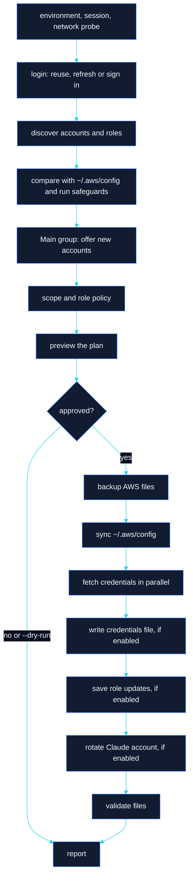

<h1> User Guide</h1>

A task-oriented walkthrough: first run, the daily workflow, and automation with `--yes`, `--json` and exit codes.

[← Back to README](../README.md) · [Docs index](README.md)

---

## Contents

1. [First run](#first-run)
2. [What Full Setup & Sync does](#what-full-setup--sync-does)
3. [Daily workflow](#daily-workflow)
4. [Choosing what to export](#choosing-what-to-export)
5. [Roles](#roles)
6. [Claude Code / Bedrock rotation](#claude-code--bedrock-rotation)
7. [Automation and CI](#automation-and-ci)
8. [Command reference](#command-reference)

## First run

**1. Check your environment.**

```sh
credorbit doctor
```

**2. Create or pick an SSO session.** If `~/.aws/config` already contains an `[sso-session]` block (for example from `aws configure sso`), CredOrbit uses it. Otherwise create one; you approve the change before it is written:

```sh
credorbit login --name acme --start-url https://d-1234567890.awsapps.com/start --region us-east-1
```

This adds the block below and signs you in:

```ini
[sso-session acme]
sso_start_url = https://d-1234567890.awsapps.com/start
sso_region = us-east-1
sso_registration_scopes = sso:account:access
```

> [!TIP]
> Migrating from the legacy script? Run `credorbit import` instead and follow [MIGRATION.md](MIGRATION.md).

**3. Run Full Setup & Sync.** In the terminal UI, choose item 1. On the command line:

```sh
credorbit setup --dry-run   # see the plan, write nothing
credorbit setup             # review the plan, then apply it
```

**4. Choose your Main Accounts** (the accounts you use every day):

```sh
credorbit setup --edit-main          # pick Main during setup when it is empty
# or later
credorbit groups add main p_acme-billing-prd p_acme-ledger-dev
```

## What Full Setup & Sync does



| Step | What happens |
|---|---|
| `environment` | OS, mode, file paths |
| `session` | Resolves `--session`, `SSO_SESSION`, `sso.default_session`, or the only session |
| `network` | Probes the SSO portal (or `network.probe_url`) and detects TLS interception; a failure is a warning only |
| `login` | Reuses a valid token, refreshes it silently, or signs you in (`--force-login`, `--device`) |
| `discover` | Lists accounts and roles; falls back to the cached discovery (read-only, no removals) if it fails |
| `roles` | Counts role assignments and accounts whose roles could not be read |
| `compare` | Counts available, new, missing and unknown accounts |
| `safeguards` | Finds stale profiles, or explains why removals are blocked |
| `main-group` | Interactive Normal mode: offers new accounts for Main (`--edit-main` fills an empty Main) |
| `scope` | `--group`, `--all`, `--profile`, `--accounts`; default Main when it has members, else all |
| `role-policy` | `--policy`, Script-compatible `script`, or `roles.policy` |
| `preview` / `approve` | One plan for profiles and credentials; applied only after approval (`--yes`) |
| `backup` | Timestamped backups of the AWS config and credentials file |
| `sync` | Adds new profiles; stale removals need separate approval (`--allow-remove`) |
| `credentials` / `export` | Fetches credentials; writes the file when export is enabled |
| `role-updates` | Persists roles that worked when enabled (`--update-roles`, `roles.update_config`, Script-compatible mode) |
| `rotate` | Only with `--rotate` or in Script-compatible mode, and not for single-profile runs |
| `validate` / `report` | Re-parses the files, checks permissions, prints the summary |

## Daily workflow

| When | Run |
|---|---|
| Start of the day | `credorbit setup` (or the TUI's Full Setup & Sync) |
| Token expired mid-day | `credorbit login` |
| Fresh credentials for your Main Accounts | `credorbit export --group main` |
| A new account was assigned to you | `credorbit sync` then `credorbit groups add main NEW_PROFILE` |
| An account went away | `credorbit sync --remove-stale` (reviewed) |
| Something looks wrong | `credorbit doctor` |
| Quick look, no network | `credorbit status` |

Normal mode does not write `~/.aws/credentials`: the AWS CLI and SDKs use your SSO profiles through the shared token cache.

```sh
aws s3 ls --profile p_acme-ledger-dev
```

If your tools need static keys, turn export on once:

```sh
credorbit config set export.enabled true
credorbit export --group main       # writes [acme-billing-prd], [acme-ledger-dev], ...
```

## Choosing what to export

| Flag | Scope |
|---|---|
| *(none)* on `export` / `sync` | Every SSO profile of the session that has the prefix (`p_` by default) |
| *(none)* on `setup` | Main when it has members, otherwise as above |
| `--all` | Every prefixed SSO profile; add `--any-prefix` for profiles without the prefix |
| `--group NAME` | Members of a saved group, for example `main` |
| `--profile NAME` | Exactly one profile, with or without the prefix |
| `--accounts a,b` | Temporary selection of account IDs or profile names (`--selected` is optional) |

Useful export options:

| Option | Effect |
|---|---|
| `--dry-run` | Show profile, section and role for each target; fetch nothing |
| `--no-write` | Fetch and verify only, even when export is enabled |
| `--parallel N` | Concurrent requests (default `export.concurrency`, 10) |
| `--policy P` | Role policy for this run |
| `--update-roles` | Persist the role that worked to `~/.aws/config` (reviewed) |
| `--fallback-role R` | Extra roles to try last with the `script` policy (repeatable) |

## Roles

```sh
credorbit roles list                          # assigned, configured and preferred role per account
credorbit roles list p_acme-ledger-dev
credorbit roles set p_acme-ledger-dev ReadOnlyAccess
credorbit export --policy strongest --group main
```

`roles set` stores a preferred role in `config.yaml` (validated against the assigned roles). Exports use it instead of `sso_role_name`; `~/.aws/config` is not changed. See [role policies](CONFIGURATION.md#role-policies).

## Claude Code / Bedrock rotation

```sh
credorbit rotate accounts set acme-bedrock-01,acme-bedrock-02   # credentials section names
credorbit rotate accounts add acme-bedrock-03
credorbit config set export.enabled true
credorbit export --group main
credorbit rotate                            # strategy from rotation.strategy (random)
credorbit rotate --strategy round-robin
credorbit rotate --set acme-bedrock-02      # pick one explicitly
credorbit rotate --verify --dry-run         # check Bedrock access, change nothing
credorbit rotate --list
```

`rotate` writes the chosen section name to `~/.claude-aws-account`. Add the shell integration once so every new shell exports it as `AWS_PROFILE`:

| Shell | Command |
|---|---|
| zsh | `credorbit rotate shell zsh >> ~/.zshrc` |
| bash | `credorbit rotate shell bash >> ~/.bashrc` |
| fish | `credorbit rotate shell fish >> ~/.config/fish/config.fish` |
| PowerShell | `credorbit rotate shell powershell >> $PROFILE` |

For Bedrock verification, set `rotation.bedrock_region` and `rotation.bedrock_model`, then `rotation.verify_bedrock true` or pass `--verify`.

> [!NOTE]
> Restart Claude Code or open a new shell after rotating.

## Automation and CI

CredOrbit never blocks on input without a terminal. Prompts are answered like this:

| Situation | Interactive | `--yes` | No terminal, no `--yes` |
|---|---|---|---|
| Plan review (sync, setup, import, role updates) | Asked | Approved | Declined with a hint |
| Non-destructive confirmation | Asked | Default answer | Declined with a hint |
| Stale profile removal | Asked (default no) | **Declined** | Declined |
| Stale profile removal with `--allow-remove` | Approved | Approved | Approved |
| Role for a new account with several roles | Asked | Skipped | Skipped |

### Examples

```sh
# Nightly refresh of the Main Accounts, writing the credentials file
credorbit setup --yes --group main --export

# Verify that access still works without touching any file
credorbit export --all --no-write --json > export-report.json

# Full script-compatible run, including reviewed removals
credorbit setup --compat --yes --allow-remove

# Fail the pipeline only on real errors
credorbit export --group main
case $? in
  0) echo "all good" ;;
  3) echo "some profiles failed" ;;
  4) echo "login needed"; exit 1 ;;
  *) exit 1 ;;
esac
```

```sh
# JSON is available on setup, discover, accounts list, export, status, doctor,
# groups list/show, roles list, rotate --list, config list and version.
credorbit status --json | jq '.sessions[] | {name, logged_in, expires_at}'
credorbit export --group main --json | jq -r '.lines[] | select(.error != null) | "\(.profile): \(.error_class)"'
credorbit doctor --json | jq -r '.[] | select(.status == "fail") | "\(.area) \(.name): \(.remedy)"'
```

Isolate CI runs from personal settings:

```sh
export CREDORBIT_CONFIG_DIR="$RUNNER_TEMP/credorbit"
export AWS_CONFIG_FILE="$RUNNER_TEMP/aws/config"
export AWS_SHARED_CREDENTIALS_FILE="$RUNNER_TEMP/aws/credentials"
```

> [!IMPORTANT]
> SSO sign-in is interactive by design. In CI, sign in beforehand with `credorbit login --device` on the runner, or rely on a token that can still be silently refreshed. Without one, commands exit with code `4`.

### Exit codes

| Code | Meaning |
|---|---|
| `0` | Success |
| `1` | Error (including a declined change and failing `doctor` checks) |
| `2` | Usage error |
| `3` | Partial success: some profiles failed |
| `4` | Needs login |
| `130` | Cancelled |

## Command reference

<details>
<summary><b>Global flags</b></summary>

| Flag | Meaning |
|---|---|
| `--session NAME` | SSO session (default: `SSO_SESSION`, `sso.default_session`, or the only one) |
| `--config DIR` | CredOrbit config directory (default: `CREDORBIT_CONFIG_DIR` or `~/.config/credorbit`) |
| `-y`, `--yes` | Approve non-destructive changes without asking |
| `--json` | Machine-readable output where supported |
| `--compat` | Script-compatible mode for this run |
| `--no-color` | Disable colours (`NO_COLOR` is honoured too) |
| `--ascii` | ASCII-only rendering |
| `--no-extra-ca` | Ignore `network.extra_cas` for this run |
| `-v`, `--verbose` | Verbose output and debug logging |

</details>

<details>
<summary><b>Commands</b></summary>

| Command | Purpose | Key flags |
|---|---|---|
| `credorbit` / `ui` | Terminal UI | `--demo`, `--screen groups\|main\|accounts\|rotate\|setup` |
| `setup` | Full Setup & Sync | `--dry-run`, `--force-login`, `--device`, `--policy`, `--no-sync`, `--export` / `--no-export`, `--update-roles` / `--no-update-roles`, `--rotate` / `--no-rotate`, `--allow-remove`, `--edit-main`, `--parallel`, `--fallback-role`, scope flags |
| `login` | Sign in, or create a session | `--force`, `--device`, `--name`, `--start-url`, `--region` |
| `logout` | Remove the cached token | |
| `discover` | Assigned accounts and roles | |
| `accounts list` | Inventory joined with your config | `--filter`, `--env prd\|stg\|dev\|test\|sandbox`, `--status available\|new\|missing\|unknown`, `--group`, `--sort name\|id\|env\|status` |
| `sync` | Update `~/.aws/config` | `--dry-run`, `--remove-stale`, `--allow-remove`, scope flags (no `--profile`) |
| `export` | Temporary credentials | `--dry-run`, `--no-write`, `--policy`, `--parallel`, `--update-roles`, `--fallback-role`, scope flags |
| `groups list\|show\|add\|remove\|create\|delete\|rename\|edit\|sync` | Account groups | `create --description` |
| `roles list [KEY]` / `roles set KEY ROLE` | Roles | |
| `rotate` | Rotate the Claude Code account | `--list`, `--set`, `--strategy random\|round-robin`, `--verify`, `--dry-run`, `--target claude` |
| `rotate accounts set\|add\|remove` | Rotation candidates | |
| `rotate shell [zsh\|bash\|fish\|powershell]` | Shell integration snippet | |
| `import` | Read the legacy script | `--script`, `--compat` |
| `config list\|get\|set\|path` | Settings | |
| `ca bundle` | Combined PEM bundle | `--out` (required) |
| `status` | Local summary, no network | |
| `doctor` | Diagnostics | |
| `update --check` | Check for a newer release | |
| `version` | Version, OS, architecture, Go version | |
| `completion bash\|zsh\|fish\|powershell` | Shell completion | |

Scope flags: `--all`, `--any-prefix`, `--group`, `--profile`, `--accounts`, `--selected`.

</details>
